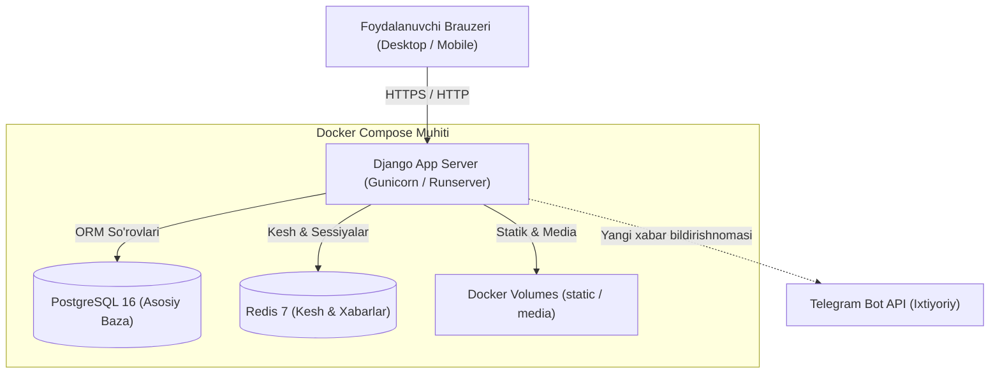
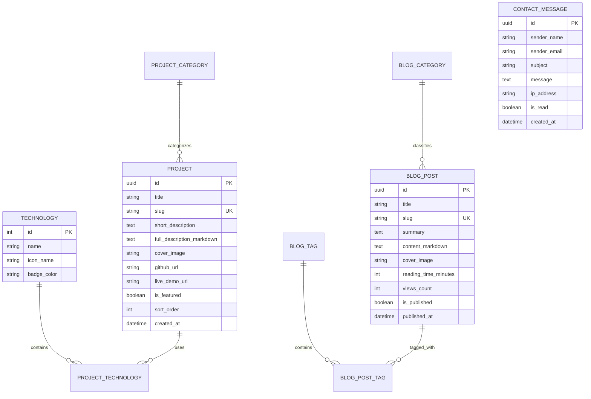

# Arxitektura Hujjati (Architecture Specification)

Ushbu hujjat **Rahmatullayev.uz** vebsaytining umumiy texnik arxitekturasi, ma'lumotlar tuzilmasi, komponentlar o'rtasidagi aloqa va loyiha papkalari tartibini ifodalaydi.

---

## 1. Tizim Arxitekturasi (System Overview)

Loyiha mikroxizmatlar murakkabligisiz, barqaror va xizmat ko'rsatish oson bo'lgan **Modular Monolith** tamoyiliga asoslanadi. Har bir soha (loyihalar, blog, sahifalar, xabarlar) alohida Django app ko'rinishida loyihalashtiriladi.



---

## 2. Docker Konfiguratsiyasi (Docker Services)

Loyiha `docker-compose.yml` orqali 3 ta asosiy xizmatni o'z ichiga oladi:

1. **`web`:**
   - Asos: `python:3.13-slim`
   - Paket menejeri: `uv`
   - O'rnatilgan paketlar orqali Django ilovasini ishga tushiradi (`uv run gunicorn` yoki dev muhitda `uv run python manage.py runserver`).
   - Muhit o'zgaruvchilari: `.env` orqali ulanishlar.
2. **`db`:**
   - Asos: `postgres:16-alpine`
   - Port: `5432`
   - Ma'lumotlar saqlanishi: `postgres_data` docker volume.
3. **`redis`:**
   - Asos: `redis:7-alpine`
   - Port: `6379`
   - Kesh saqlanishi: `redis_data` docker volume.

---

## 3. Papkalar va Fayllar Tuzilmasi (Project Directory Structure)

```text
rahmatullayev-uz/
├── .env.example              # Muhit o'zgaruvchilari namunasi
├── .gitignore                # Git e'tiborsiz qoldiradigan fayllar
├── Dockerfile                # Ko'p bosqichli tezkor Dockerfile (uv bilan)
├── docker-compose.yml        # Web, DB va Redis konteynerlari
├── pyproject.toml            # uv bog'liqliklari va loyiha konfiguratsiyasi
├── uv.lock                   # Qulflangan aniq versiyalar
├── README.md                 # Loyihani ishga tushirish qo'llanmasi
├── GEMINI.md                 # Loyiha umumiy talablari
├── ARCHITECHTURE.md          # Texnik arxitektura hujjati
├── PLAN.md                   # Bajariladigan ishlar bosqichlari
│
├── config/                   # Django loyiha konfiguratsiya yadrosi
│   ├── __init__.py
│   ├── asgi.py
│   ├── wsgi.py
│   ├── urls.py               # Asosiy URL marshrutlari
│   └── settings/             # Sozlamalar modullari
│       ├── __init__.py
│       ├── base.py           # Umumiy sozlamalar (apps, middlewares, db template)
│       ├── local.py          # Dasturlash muhiti (DEBUG=True)
│       └── production.py     # Jonli server muhiti (DEBUG=False, SSL, WhiteNoise)
│
├── apps/                     # Django ilovalari (Modular Apps)
│   ├── common/               # Umumiy utils, mixinlar, base modellar (TimeStampedModel)
│   ├── pages/                # Bosh sahifa, Men haqimda (About), Tarjimai hol (Resume)
│   ├── projects/             # Loyihalar katalogi (Project, Technology, Category)
│   ├── blog/                 # Maqolalar, blog postlar (Post, Tag, Category)
│   └── contact/              # Bog'lanish shakli, xabarlarni qabul qilish va Telegram alert
│
├── templates/                # HTML Shablonlar (Django Template Engine)
│   ├── base.html             # Asosiy layout (Head, Navbar, Footer, Theme Switcher)
│   ├── components/           # Qayta ishlatiluvchi bloklar (navbar, footer, cards, badges)
│   ├── pages/                # Pages app shablonlari (index.html, about.html)
│   ├── projects/             # Projects shablonlari (list.html, detail.html)
│   ├── blog/                 # Blog shablonlari (list.html, detail.html)
│   └── contact/              # Contact shablonlari (contact.html, success.html)
│
├── static/                   # Statik fayllar (Frontend manbalari)
│   ├── css/
│   │   ├── input.css         # Tailwind asosiy kiruvchi fayli
│   │   └── output.css        # Kompilyatsiya qilingan CSS
│   ├── js/
│   │   ├── theme.js          # Dark/Light mode toggle logikasi
│   │   └── main.js           # Sayt umumiy interaktiv skriptlari
│   └── images/               # Logotiplar, favicon, avatarlar
│
└── media/                    # Foydalanuvchi/Admin yuklaydigan fayllar (loyihalar rasmlari, post rasmlari)
```

---

## 4. Ma'lumotlar Bazasi Modellari (Data Models & ERD)



---

## 5. Kesh va Unumdorlik Strategiyasi (Redis Caching)

1. **Statik Sahifalar:** `Home`, `About` sahifalari kam o'zgargani sababli Redis keshida (masalan, 1 soat) saqlanadi.
2. **Blog & Projects Listing:** Filtrlangan va saralangan ro'yxatlar Redis keshida saqlanadi.
3. **Keshni yangilash (Cache Invalidation):**
   - Django `post_save` va `post_delete` signallari orqali: Admin tomonidan yangi blog post yoki yangi loyiha qo'shilganda/o'zgartirilganda unga tegishli kesh kalitlari darhol o'chiriladi (invalidation).

---

## 6. Dark / Light Mode Arxitekturasi

- **Tailwind Konfiguratsiyasi:** `darkMode: 'class'` rejimi.
- **HTML Element:** `<html class="dark">` yoki `<html class="light">`.
- **FOUC (Flash of Unstyled Content) oldini olish:**
  - `<head>` tegining eng yuqori qismida kichik inline JavaScript joylashtiriladi:
    ```javascript
    if (localStorage.theme === 'dark' || (!('theme' in localStorage) && window.matchMedia('(prefers-color-scheme: dark)').matches)) {
      document.documentElement.classList.add('dark');
    } else {
      document.documentElement.classList.remove('dark');
    }
    ```
- **Tugma (Switcher):** Foydalanuvchi tugmani bosganda sinf almashadi va `localStorage.theme` yangilanadi.
